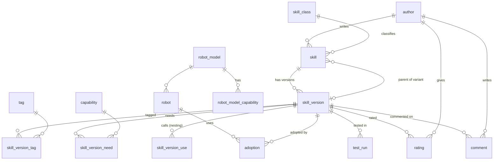

# RS Library Database Design (draft)

This is how the open RS library stores skills, so that it can find them quickly, give each one a global ID, and show how well each skill works in practice. The SQL is in [`library/`](../library/):

| File | Contents |
| --- | --- |
| [`schema.sql`](../library/schema.sql) | Tables, indexes, the rating rule and the ranking views (PostgreSQL) |
| [`queries.sql`](../library/queries.sql) | Six typical lookups, with indexed access paths where applicable |
| [`sample-data.sql`](../library/sample-data.sql) | A small data set: three skills, one variant, two robot models |
| [`tests.sql`](../library/tests.sql) | Transactional regression checks and a smoke run of the six queries |

The SQL targets PostgreSQL 14 or later. Run the following against a fresh, disposable database using `psql`; `ON_ERROR_STOP` makes failures visible:

```text
psql -X -v ON_ERROR_STOP=1 -d rs_test -f library\schema.sql -f library\sample-data.sql -f library\tests.sql
```

The tests require the sample data and roll back their own changes. Schema changes here are a fresh-install prototype, not an upgrade migration for an existing library.

## Global unique IDs

Entity records use UUID version 7 ([RFC 9562](https://www.rfc-editor.org/rfc/rfc9562)); vocabulary and join tables use their own keys. These are 128-bit IDs that anyone can generate without asking a central server, with an extremely low collision probability. Version 7 starts with a timestamp, which generally improves index locality. The generator does not guarantee ordering within a millisecond or across clock changes. The prototype generates v7 defaults but does not validate the version of every supplied UUID.

A skill has three kinds of identity, each for a different job:

| Identity | Example | Stays the same when... | Used for |
| --- | --- | --- | --- |
| `skill_id` (UUID) | `0192f3a4-7c1e-7b2a-...` | a new version of the same skill is published | "the bottle-opening skill by this author", links between skills |
| `version_id` (UUID) | `0192f3b0-...` | never; one per published version | ratings, comments, usage counts, test results |
| `sha256` (content hash) | `9b1c...` | never; any changed byte changes it | download integrity and `parent` links to exact packets; signature verification is separate |

The `skill_id` is written in the skill file itself (a new `id` line in the contract), so the ID travels with the skill wherever it is copied. A variant gets a **new** `skill_id` and a `parent` link to the exact version it came from.

The database checks that `sha256` is the SHA-256 digest of `packet`, including the signed envelope. It does not verify COSE signatures. The sample packets are distinct dummy byte strings with matching digests, not executable or signed packets. Adding a signature changes the packet hash; the final publication envelope and hash must be settled before a version is listed.

## Tables at a glance



- **skill / skill_version:** the catalogue. The signed packet (usually 2 to 16 KB) is stored right in the version row, so one indexed read returns everything a robot needs.
- **skill_class / tag / capability:** the shared vocabularies from the spec. Class codes are stored as text (`6.1.1`) with a prefix index, so "everything under RS 6" is one index range scan.
- **skill_version_need / robot_model_capability:** filter candidates by explicitly declared capability counts. They do not establish that a skill can safely run.
- **skill_version_use:** which skills a skill calls, so the library can fetch a whole skill set in one go and warn when a building block changes.
- **adoption, test_run, rating, comment:** the community signals described below.

## Measuring how good a skill is

A skill adopted by many robots is probably better than one used by few, but popularity alone can mislead: a new skill has no users yet, and a popular skill may still fail often. So the library records three separate signals and combines them carefully.

| Signal | Where it comes from | Why it is hard to fake |
| --- | --- | --- |
| **Adoption**: how many robots installed it, and how many used it in the last 30 days | Usage reports sent by robots, signed with each robot's own key | Each robot counts once; reports without a valid robot signature are ignored |
| **Success rate**: successful runs out of all runs | The same usage reports, using the skill's own `success` check | Measured by the robots, not claimed by people |
| **Ratings**: 1 to 5 stars | People | One rating per person per version, and only from someone whose robot has actually adopted the version (enforced by a database trigger) |

**Ranking.** Each listed version gets a score from 0 to 1:

- 50% success rate, scored cautiously: 9 successes out of 10 runs scores lower than 900 out of 1000, because there is less evidence (Wilson lower bound).
- 30% active adoption, on a logarithmic scale, so going from 1 to 10 robots counts as much as 100 to 1000.
- 20% star rating, pulled toward 3 stars until about 10 people have rated (a Bayesian average), so one 5-star rating can't put a skill on top.

The weights are a starting point and should be tuned once real data exists. Counting all of this on every search would be slow, so the totals live in a summary view (`skill_version_stats`) that is refreshed every few minutes without blocking readers.

The refresh must be scheduled by the operator; no scheduler is included. `skill_version_rank` checks the current version status as well, so a withdrawn version disappears from rankings immediately rather than waiting for refresh. New listings and changed counts still wait for refresh. Consumers of the materialized statistics directly must also check live listing status.

**Comments** are threaded (replies point at their parent), attached to a specific version, and can be hidden by moderators without being deleted. A foreign key prevents replies across versions, and a check prevents self-replies. Query 6 traverses arbitrarily deep visible threads in chronological depth-first order; a visible reply to a hidden parent starts a new displayed thread. The service must reject longer ancestry cycles when reparenting comments. Variant traversal uses PostgreSQL's cycle detection so malformed ancestry cannot cause unbounded recursion.

**Ingestion is not implemented.** The server must verify authorship and robot-report signatures, authorize ownership changes, reject replayed reports, and enforce publication transitions. A `library_signed_at` timestamp alone is not evidence of a valid signature or a passing test. Signed reports also do not prove a robot's identity is unique or its measurements honest; the ranking is an evidence signal, not safety certification.

## Fast retrieval

The common lookups and the index behind each:

| Lookup | Served by |
| --- | --- |
| Skill by global ID, newest version | Primary key, plus a partial index on listed versions ordered by version number |
| Exact packet by content hash | Unique index on `sha256` |
| Everything under a class code | Prefix index on `class_code` |
| By tag (for example `tool:iron`) | Index on `(tag_id, version_id)` |
| Text search on name and title | Full-text (GIN) index |
| Capability candidates for a robot model | Primary keys on needs and capabilities |
| Variant family tree | Index on `parent_version_id` |
| Best first | Summary view with its own unique index |

With the sample data, query 4 shows the point of variants: a one-armed robot passes the explicit capability filter for the lever-opener variant but not the original two-handed skill. This is a catalogue demonstration, not a verified one-handed opening technique. Physical limits, action support, inferred capabilities, nested requirements, signatures and scene preconditions still need validation outside this query.

## Other databases

The design uses plain relational tables, so it ports to other databases, including the ones Delphi's FireDAC supports:

- **UUIDs:** PostgreSQL has a `uuid` type. Elsewhere use `BINARY(16)` (MySQL), `UNIQUEIDENTIFIER` (SQL Server), `CHAR(16) CHARACTER SET OCTETS` (Firebird) or a 16-byte `BLOB` (SQLite), and generate UUID v7 in application code.
- **Summary view:** replace the materialized view with an ordinary table refreshed by a scheduled job.
- **Rating rule:** keep it as a trigger, or check it in the library's server code.
- **Full-text search:** use the database's own full-text feature (SQLite FTS5, MySQL FULLTEXT) or an external search engine.

A robot's own local store can be much smaller: SQLite with just the skills it has installed and its learning records.

## Privacy

- Robots are identified by a random ID and key, not by owner. An owner link is optional and is only used to check who may rate.
- Location is a country code at most.
- Usage reports carry counts, not video, audio or anything about the home.

## Open questions

- How long to keep per-robot adoption rows, and whether to store only totals after some period.
- Moderation rules for comments and for withdrawing a harmful skill.
- Whether the library should be one central database or several mirrors that sync, given every record already has a global ID and a content hash.
