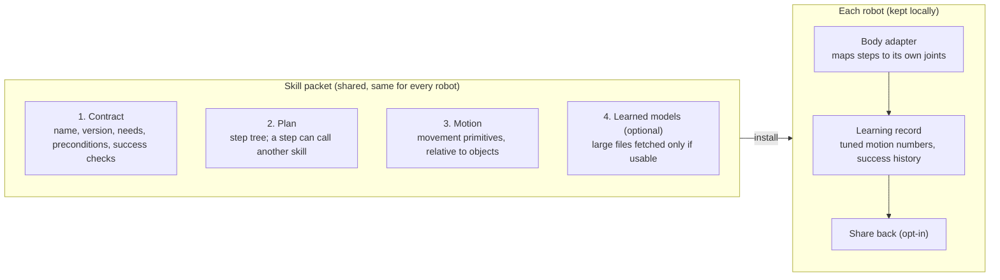
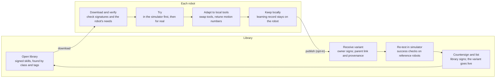

# Robot Skills (RS) Specification v0.1 Draft

Draft dated 2026-10-27. Not yet stable: everything may change.

## Status

RS v0.1 is a first draft for review, not a stable standard. It proposes one skill file with four layers (Contract, Plan, Motion, optional Models) plus Provenance and Signatures. The intended source forms are a small RS grammar and YAML, compiling to a signed CBOR packet with a target size of roughly 2 to 16 KB. An initial [YAML/JSON authoring validator and JSON Schema](../docs/validator.md) implement a bounded subset, not the complete draft. No `.rsk` parser, packet compiler or robot runtime is implemented yet; packet sizes are estimates, not measurements.

Decisions built in: a new grammar with a YAML option; robot capabilities based on RoboEarth's SRDL; action words and class codes based on VDI 2860; class codes plus tags; variants that link to their parent; signed provenance. Licence: Apache 2.0 for this spec and its tools; library skills default to CC BY 4.0. Still open: the complete grammar, execution and motion semantics, signing details, and reproducible simulator tests (see [Open questions](#open-questions-for-v02)).

Keywords **must**, **should** and **may** carry their usual standards meaning: required, recommended, optional.

## Safety scope and manufacturer responsibility

Robot safety is the responsibility of the robot manufacturer, not the RS skill format, library or authoring validator. The manufacturer is responsible for the robot's safety architecture, protective controls, operating limits and safety validation of skill execution on its platform. RS is a task-description and interchange format, not a robot safety standard or certification scheme. This technical scope statement does not determine legal liability or replace applicable safety obligations.

An RS skill **must not** disable, bypass or override manufacturer-provided safety protections. The manufacturer's controller **must** retain authority to reject, limit or stop a requested action, including actions in nested skills and locally adapted variants.

Skill-level `limits`, `abort` conditions and action force caps describe task requirements and constraints; they are not substitutes for the manufacturer's independent safety controls. Passing source validation, matching a capability profile, carrying a valid signature or passing simulator tests does not establish that a skill is safe to execute on a particular robot or in a particular environment.

## Overview

The packet is the same for every robot; what each robot learns stays with that robot unless its owner chooses to share it.



## Worked example

The following abbreviated sketch shows "open a bottle with an opener". The full illustrative source is [`examples/skills/open-bottle-with-opener.rsk`](../examples/skills/open-bottle-with-opener.rsk). Its keys and motion weights are placeholders, so it is not executable or publishable; the estimated packet size has not been measured.

```text
rs 0.1

skill open-bottle-with-opener 1.0.0 {
  id      0192f3a4-7c1e-7b2a-9d4e-5a1f6c3b8e20   # global ID (UUID v7), same for all versions
  title   "Open a capped bottle with a bottle opener"
  class   RS 2.1.2                        # Changing quantity > Divide > Detach a part
  tags    object:bottle object:crown-cap tool:bottle-opener
          body:two-hands domain:kitchen

  needs   ArmMotion x2, GripperMotion x2, Grasping, ForceSensing, Camera
  limits  payload >= 1.0 kg, grip_force >= 40 N

  objects {
    bottle : Bottle       { has neck : Neck, cap : CrownCap }
    opener : BottleOpener { has lip : Edge, handle : Handle }
  }

  pre     upright(bottle), capped(bottle), reachable(opener)
  effect  not capped(bottle)
  success not capped(bottle) and upright(bottle) within 30 s
  abort   force > 80 N or not upright(bottle)

  plan sequence {
    use grasp-object >=1.0 (target: bottle.neck, hand: left)
    use grasp-object >=1.0 (target: opener.handle, hand: right)
    position opener.lip to bottle.cap.rim  motion: approach
    retry 3 {
      rotate opener about opener.lip by 25 deg  motion: lever  force <= 40 N
      check not capped(bottle)
    }
    release opener
  }

  motion approach : dmp { frame bottle.cap  dims 6  basis 20  duration 1.5 s  weights @w_approach }
  motion lever    : dmp { frame opener.lip  dims 6  basis 15  duration 0.8 s  weights @w_lever }

  data w_approach : f16[120] = b64"..."
  data w_lever    : f16[90]  = b64"..."

  provenance {
    author  "A. Contributor"  key ed25519:3f9a...
    created 2026-10-27
    modified 2026-10-27
    origin  recorded { devices: camera, microphone  region: "GB" }
    tested  sim:mujoco  robots: generic-humanoid  runs: 50  passed: 47
    licence CC-BY-4.0
  }
}
```

How to read it: the header says what the skill is and what a robot needs; `plan` is the step tree; `use` calls another skill (nesting); `position`, `rotate`, `release` and `check` are VDI 2860 action words; each `motion` is a small set of numbers stored in `data`, placed relative to the bottle or opener rather than to any robot's body.

## Grammar rules

The grammar is intended to be small enough to implement in any language, including Delphi. The EBNF below is a sketch, not a complete parser grammar: lexical rules, several productions, robot profiles and action-specific operands remain to be specified for v0.2.

- **Files:** UTF-8 text, extension `.rsk` for source and `.rsp` for a compiled packet (`.rs` is avoided because Rust uses it). The first line **must** be `rs <major>.<minor>`.
- **Blocks** use `{ }`. A statement ends at a line break, unless brackets are still open, the line ends with a comma, or the next line is indented further (a continuation). Otherwise indentation is only for readability.
- **Comments** start with `#` and run to the end of the line.
- **Names** are lower-case words joined by hyphens (`open-bottle-with-opener`); object types and capabilities are CamelCase (`BottleOpener`, `ForceSensing`).
- **Versions** follow semantic versioning (`1.0.0`). A `use` call gives a version range (`>=1.0`).
- **Quantities** always carry a unit from a fixed SI list: `m`, `mm`, `deg`, `rad`, `s`, `ms`, `N`, `Nm`, `kg`. A bare number is a count.
- **References** use dots to reach parts of objects (`bottle.cap.rim`) and `@` to point at a `data` block.
- **Unknown keywords** inside an `ext.<vendor>` block **must** be ignored by readers, so vendors can add fields without breaking others.

```ebnf
file        = header skill ;
header      = "rs" version-mm ;
skill       = "skill" name semver "{" { section } "}" ;
section     = id | title | class | tags | needs | limits | objects | pre | effect
            | success | abort | plan | motion | model | data | provenance | ext ;
plan        = "plan" node ;
node        = control "{" { node } "}" | select | action | use | check ;
select      = "select" "{" { "when" condition ":" node } [ "else" ":" node ] "}" ;
control     = "sequence" | "fallback" | "parallel" | "retry" count | "repeat" count ;
action      = verb ref [ "to" ref | "about" ref ] [ "by" quantity ] { option } ;
use         = "use" name [ range ] "(" [ arg { "," arg } ] ")" ;
check       = "check" condition ;
condition   = [ "not" ] predicate { ( "and" | "or" ) [ "not" ] predicate } ;
motion      = "motion" name ":" kind "{" { field } "}" ;
data        = "data" name ":" numtype "[" count "]" "=" ( "b64" string | list ) ;
```

## Contract layer

The contract is everything a robot or library needs to decide whether a skill fits, without reading the plan.

| Field | Required | Meaning |
| --- | --- | --- |
| `skill <name> <version>` | must | Name plus semantic version |
| `id` | must | Global unique ID (UUID version 7, RFC 9562) for this skill. It stays the same across versions; a variant gets a new `id` and a `parent` link. Generated by the authoring tool when the skill is first created |
| `title` | must | One line for people |
| `class` | must | One RS class code (see [Classification](#classification)) |
| `tags` | should | Facet tags `facet:value` (see [Classification](#classification)) |
| `needs` | must | Capabilities the robot must have, with counts (`ArmMotion x2`) |
| `limits` | may | Minimum physical limits: payload, reach, grip force |
| `objects` | must | Named roles the skill acts on, each with a type and named parts |
| `pre` | must | Conditions that must hold before starting |
| `effect` | must | Conditions that will hold after success; planners chain skills with these |
| `success` | must | The test that decides the skill worked, with a time limit |
| `abort` | should | Conditions that stop the skill at once (too much force, object fell) |

Conditions are predicates on objects (`upright(bottle)`, `capped(bottle)`). v0.1 defines a starter list of predicates; any other predicate **must** come from a used skill's effects or an `ext` block, so a robot never meets a word it cannot test.

## Plan layer

The plan is a tree: control nodes decide order, and leaves are actions, checks or calls to other skills. The structure follows behavior trees, so it maps directly onto BehaviorTree.CPP or py_trees at run time.

### Control nodes

| Node | Behaviour |
| --- | --- |
| `sequence { }` | Run children in order; fail as soon as one fails |
| `select { when ...: ... else: ... }` | Check each `when` condition in order and run only the first branch whose condition holds now; run `else` if none does; fail if there is no `else` |
| `fallback { }` | Try children in order; succeed as soon as one succeeds (for alternatives, such as "use the opener, else use a spoon") |
| `parallel { }` | Run children at the same time, such as two hands; succeed when all succeed |
| `retry N { }` | Re-run the block up to N times until it succeeds |
| `repeat N { }` | Run the block exactly N times |
| `use <skill> <range> (args)` | Run another skill; its success and effects count as this step's |
| `check <condition>` | Succeed if the condition holds now |

### Choosing between skills: `select` versus `fallback`

Use `select` when the robot can tell **before acting** which way to go, for example from the type of cap it sees. Use `fallback` only when the right choice can be found out by trying, and a failed attempt is harmless. With physical objects a failed try can spill or break things, so `select` is preferred.

A common pattern is a thin "chooser" skill that looks at an object and calls the specific skill for it. Specific skills are split by **mechanism**, not by container: unscrewing a bottle cap and a jar lid is one skill with different size and torque, while a crown cap, a ring-pull and a can opener are separate skills.

```text
skill open-container 1.0.0 {
  id      0192f3a5-0a10-7c44-8b1e-2f7d9e6a4c01
  title   "Open a closed container"
  class   RS 2.1.2
  objects { box : Container { has closure : Closure } }
  pre     closed(box)
  effect  open(box)
  success open(box) within 60 s

  plan sequence {
    inspect box.closure
    select {
      when is(box.closure, CrownCap): use open-crown-cap >=1.0 (target: box)
      when is(box.closure, ScrewCap): use unscrew-cap    >=1.0 (target: box)
      when is(box.closure, RingPull): use pull-ring-tab  >=1.0 (target: box)
      when is(box.closure, CanLid):   use open-tin-can   >=1.0 (target: box)
    }
    check open(box)
  }
}
```

`is(<object>, <Type>)` is true when the object is of that type or a subtype of it. Object types form a tree (for example `Closure` has subtypes `CrownCap`, `ScrewCap`, `RingPull` and `CanLid`), so skills can be written for a general type and still match specific ones.

The chooser deliberately has no `else`: an unsupported closure makes `select` fail instead of treating a spoken explanation as successful opening. The final check verifies the promised effect. The called skills are illustrative dependencies, not supplied implementations; the chooser's needs cannot be considered complete until those dependencies and their requirements are resolved.

### Action words (from VDI 2860)

Every action leaf **must** use one of these verbs. They are the shared vocabulary, so a robot only needs to implement this list once to run any skill. English names are working translations of the VDI 2860 handling functions.

| VDI 2860 group | RS verbs | Example |
| --- | --- | --- |
| Storing | `store`, `stack`, `retrieve` | `store cup in cupboard.shelf` |
| Changing quantity | `separate`, `allocate`, `combine`, `sort` | `combine lid with jar` |
| Moving | `rotate`, `shift`, `orient`, `position`, `order`, `guide`, `convey` | `rotate opener about opener.lip by 25 deg` |
| Securing | `hold`, `release`, `clamp`, `unclamp` | `hold bottle.neck with left` |
| Checking | `inspect`, `measure`, `count` | `measure shirt.wrinkles` |
| RS additions (not in VDI 2860) | `apply` (force or heat to a surface), `walk`, `look-at`, `say`, `wait` | `apply iron to shirt.front with 20 N` |

Action options: `motion: <name>` picks the movement, `force <= <q>` caps force, `speed <= <q>` caps speed, `with <hand>` names a hand. A robot **may** perform an action with its own controller when no motion is given.

## Motion layer

Motions describe where the hand or tool goes, relative to an object, never joint angles of a particular robot. Each robot's body adapter turns that path into its own joint moves (inverse kinematics), which is what lets one skill run on different bodies.

### Motion kinds in v0.1

| Kind | Stores | Typical size | Use for |
| --- | --- | --- | --- |
| `dmp` | Dynamic movement primitive: basis-function weights per dimension | 6 dims x 15 to 30 weights, about 200 to 400 bytes at f16 | Smooth movements that must adapt to a new start or goal |
| `promp` | Probabilistic movement primitive: mean and spread of weights | About twice a `dmp` | Movements with natural variation, learned from several demonstrations |
| `spline` | A few waypoints with times | 10 to 50 bytes per waypoint | Simple point-to-point moves, hand-written skills |
| `force` | Force or torque profile over time | Similar to `spline` | Pressing, levering, ironing |

**Required fields:** `frame` (the object part the motion is relative to), `dims` (6 for position plus rotation; 7 if gripper opening is included), `duration`, and the numbers via `weights @name` or `points @name`.

**Frames and units:** positions in metres, angles in radians internally (the text form accepts `deg`), right-handed axes with z up. Every named object part defines its own frame, so `bottle.cap` means "origin at the cap centre, z along the bottle axis".

**Data blocks:** `data <name> : <type>[<count>]` holds numbers as `f16`, `f32` or `i16`, written in base64 or as a list. f16 is the proposed default and halves the storage compared with f32, but quantizing motion weights does not guarantee a particular end-effector accuracy. Precision must be evaluated using the specified motion model and task tolerances; a skill that needs more numeric precision uses f32.

## Robot capabilities

Each robot publishes a short profile; a skill runs only if every `needs` entry and `limits` value is met. The capability names come from RoboEarth's [SRDL](https://knowrob.org/srdl2_tutorial), simplified to plain names. Example: [`examples/robots/generic-humanoid.rsk`](../examples/robots/generic-humanoid.rsk).

```text
rs 0.1

robot generic-humanoid 1.0 {
  body    urdf "generic-humanoid.urdf"     # existing body description, reused as is
  has     BaseMotion, Walking, ArmMotion x2, GripperMotion x2, Grasping,
          FingerMotion x2, ForceSensing, Camera, DepthCamera, Microphone, Speaker
  limits  payload 3.0 kg, reach 0.7 m, grip_force 60 N
  actions all                              # implements every VDI 2860 verb
}
```

**Matching rule (from SRDL):** a capability counts as present if the profile lists it, or if everything it depends on is present (for example `Grasping` needs `ArmMotion` and `GripperMotion`). If a need is missing, the robot reports exactly which one, so the library can suggest a variant that avoids it, such as a one-handed version.

**Starter list:** `BaseMotion`, `Walking`, `ArmMotion`, `GripperMotion`, `FingerMotion`, `Grasping`, `Bimanual`, `ForceSensing`, `TactileSensing`, `Camera`, `DepthCamera`, `Microphone`, `Speaker`. New names are added through the same review process as class codes.

## Classification

Every skill has one class code for what it mainly does, plus tags for everything else. Classes 1 to 5 follow the five VDI 2860 groups, so the class matches the action words; 6 to 8 are RS additions for work VDI 2860 does not cover.

| Code | Class | Example sub-classes |
| --- | --- | --- |
| RS 0 | Complete tasks (jobs combining several classes) | 0.1 meal preparation, 0.2 laundry cycle |
| RS 1 | Storing | 1.1 put away, 1.2 stack, 1.3 retrieve |
| RS 2 | Changing quantity | 2.1 divide (2.1.2 detach a part: open a bottle), 2.2 combine, 2.3 allocate, 2.4 sort |
| RS 3 | Moving | 3.1 rotate, 3.2 shift, 3.3 orient, 3.4 position, 3.5 guide, 3.6 carry |
| RS 4 | Securing | 4.1 hold, 4.2 release, 4.3 clamp, 4.4 unclamp (4.1.1 grasp an object) |
| RS 5 | Checking | 5.1 inspect, 5.2 measure, 5.3 count |
| RS 6 | Processing: changing an object's shape or state | 6.1 press and smooth (6.1.1 iron a garment), 6.2 cut, 6.3 fold, 6.4 clean, 6.5 mix |
| RS 7 | Getting around | 7.1 walk, 7.2 climb stairs, 7.3 open doors |
| RS 8 | Working with people | 8.1 hand over, 8.2 assist, 8.3 speak and listen |
| RS 9 | Reserved for experiments | 9.x free for trials before a code is assigned |

**Open-ended rule:** any branch can grow deeper (`RS 6.1.1.3`), so the system never runs out of room. Anyone can propose a new code; the library assigns it after review, and a code is never reused once retired.

**Tags** cover the other dimensions and are what people mostly search by:

| Facet | Examples |
| --- | --- |
| `domain` | home, kitchen, laundry, factory, care, garden |
| `object` | bottle, shirt, cup |
| `tool` | bottle-opener, iron |
| `body` | one-hand, two-hands, standing, seated |
| `material` | glass, fabric, food |
| `risk` | heat, sharp, fragile, near-people |

The code says what the robot physically does; the setting (home, laundry, factory) is the `domain` tag.

## Lifecycle, variants, provenance and signing

A robot can change a skill freely for its own use; a change only reaches other robots after it is signed by its owner, re-tested and countersigned by the library.



**Variants.** A published adaptation gets a new `id` and its own version history. Its name may stay the same or change; names alone are not unique identities. A `parent` line identifies the exact version it came from (skill ID, version and content hash; a name may also be included for display). A new version of the same skill keeps its existing `id`. The library shows variants as a family tree, so a good adaptation (say, for a lever-style opener) sits beside the original instead of replacing it.

**Learning record.** Kept on the robot in a separate `.rsl` file: retuned motion numbers, tool swaps, success and failure counts. It is not shared unless the owner publishes a variant, at which point the useful parts are folded into the new version.

**Provenance block (must be present in every published skill):**

| Field | Required | Content |
| --- | --- | --- |
| `author` | must | Display name and public key |
| `created`, `modified` | must | Dates (ISO 8601) |
| `parent` | must for variants | Skill ID, version and SHA-256 hash of the parent packet; optional display name |
| `origin` | must | `written`, `recorded` (from a person) or `learned` (by a robot), with details |
| `robot` | should | Robot model the skill was made or adapted on |
| `region` | may | Country or region code only, never an address |
| `tested` | must for library listing | Simulator, reference robots, runs and passes |
| `licence` | must | CC-BY-4.0 by default; CC0-1.0 allowed |

**Signing.** The packet's content is hashed (SHA-256) and signed with the author's Ed25519 key. The library adds a second signature after its tests pass. A robot **should** refuse a skill without a valid author signature, and **may** be set to require the library signature too. A changed byte breaks the signature, so a tampered skill is detected before it runs.

## Skills recorded from a person

A recorded skill is an ordinary RS skill; the only difference is its `origin` block, which says how it was captured so others can judge and repeat it. The raw video and audio are never inside the packet.

```text
origin recorded {
  devices     camera x2, microphone          # e.g. two phones and a headset
  tracking    hands, body, objects           # what was tracked
  demos       5                              # number of demonstrations used
  narration   yes                            # speech used to name and split steps
  tool        "rs-record 0.1"                # software that produced the skill
  recording   sha256:9b1c...  licence CC-BY-4.0  optional
}
```

- `recording` **may** point to the raw dataset by hash, stored elsewhere (for example in LeRobot dataset format), so the skill can be regenerated or improved later. It **must not** be required to run the skill.
- Faces and voices in a recording are personal data. The recording tool **should** blur faces and drop audio after transcription by default, and the person recorded **must** consent before a recording is linked from the library.
- The recording pipeline itself (tracking, splitting into steps, fitting motions) is tooling, not part of the format.

## Binary packet and YAML form

The intended conversion is from `.rsk` text, or the same content in YAML, to one `.rsp` binary packet. Lossless semantic conversion between source forms and the decoded payload is a v0.2 goal, not an implemented feature. Source comments and formatting are not preserved; reconstructing a payload alone does not reconstruct the original signed envelope.

### Packet layout

1. **Payload:** the skill as a CBOR map ([RFC 8949](https://www.rfc-editor.org/rfc/rfc8949)) in deterministic encoding, so the same normalized skill produces the same payload bytes. Field names are intended to become small integers; the key table and normalization rules are not assigned yet.
2. **Signatures:** the payload is wrapped in a COSE_Sign structure ([RFC 9052](https://www.rfc-editor.org/rfc/rfc9052)), which holds several signatures over the same bytes: the author's, then the library's. Algorithm: EdDSA with Ed25519.
3. **Models:** never embedded. A `model` entry gives a name, format, size and SHA-256 hash; robots fetch it separately if they can use it.

**Hash boundaries:** the library's `sha256` identifies the complete stored `.rsp` packet, including its COSE envelope and signatures. Adding a library signature changes that packet hash even if the payload is unchanged. Author submission hashes therefore cannot be assumed to equal the final listed packet hash. v0.2 must define the exact COSE protected headers, signature inputs, countersigning workflow and whether a separate payload hash is needed. A packet hash is not a substitute for signature verification.

**Size targets:** a packet without models **should** be under 16 KB. The open-bottle example's roughly 2 KB target remains unverified until real motion data and an encoder exist.

### YAML form

An abbreviated YAML sketch, for people and tools that prefer it (full illustrative file: [`examples/skills/open-bottle-with-opener.yaml`](../examples/skills/open-bottle-with-opener.yaml)):

```yaml
rs: "0.1"
skill: open-bottle-with-opener
version: 1.0.0
class: RS 2.1.2
tags: [object:bottle, tool:bottle-opener, body:two-hands, domain:kitchen]
needs: [ArmMotion x2, GripperMotion x2, Grasping, ForceSensing, Camera]
pre: [upright(bottle), capped(bottle), reachable(opener)]
effect: [not capped(bottle)]
plan:
  sequence:
    - use: {skill: grasp-object, version: ">=1.0", target: bottle.neck, hand: left}
    - position: {what: opener.lip, to: bottle.cap.rim, motion: approach}
    - retry: {times: 3, do: [{rotate: {what: opener, about: opener.lip, by: 25 deg}}]}
```

A [JSON Schema](../src/robot_skills/skill.schema.json) and [Python validator](../docs/validator.md) now implement the explicitly versioned `rs-0.1-authoring-v1` subset. The profile documents its supported source shapes and limitations; it does not settle the full v0.2 format. The validator checks selected semantics, references, units and numeric data, but does not resolve dependencies or verify signatures. The placeholder bottle example remains intentionally invalid.

## Open questions for v0.2

- [ ] **Executable format:** complete the grammar and YAML/JSON Schema, define one normalized data model and supply valid fixtures plus parser/validator round-trip tests. Specify version-range syntax, required versus ignorable extensions, and resolve `use` calls by stable skill ID, not an ambiguous name alone.
- [ ] **Execution semantics:** define running/success/failure, condition precedence and unknown observations, timeouts, retries, cancellation and parallel resource conflicts. Abort and robot-local safety limits must not be bypassed by nested calls.
- [ ] **Motion interoperability:** define DMP/ProMP equations and parameters, orientation representation, spline/force layouts, numeric byte order and validity checks; weights and dimension counts alone do not define a portable trajectory.
- [ ] **Capability matching:** define count-aware inference and branch/dependency requirements. Distinguish catalogue candidates from runtime checks of physical limits, actions and the actual scene.
- [ ] **Publication and trust:** fix payload versus envelope hashing, COSE details, key trust and revocation, dependency pinning, and the simulator result required before listing. Define SemVer prerelease ordering and how the database's version columns are kept consistent.
- [ ] **Predicates:** agree the starter list (`is`, `upright`, `capped`, `reachable`, `holding`, `open`, `closed`, `on`, `in`, ...) and how a robot proves each one, usually by camera.
- [ ] **Object types:** reuse an existing object vocabulary or keep our own short list? Types need named parts (`cap`, `handle`) with standard frames.
- [ ] **Simulator tests:** a standard test-scene format so the library's re-test is repeatable. MuJoCo scene files are the likely base.
- [ ] **Body adapter interface:** the exact calls a robot must provide for each VDI 2860 verb. This becomes the porting guide for robot makers.
- [ ] **CBOR key table:** fix the integer key for every field.
- [ ] **Translations of VDI 2860 terms:** confirm the English verb names against the official standard text.

## References

- [VDI 2860 Blatt 1, handling functions](https://vdi.de/en/home/vdi-standards/details/vdi-2860-blatt-1-assembly-and-handling-units-handling-functions-handling-units-terminology-definitions-and-symbols)
- [KnowRob SRDL tutorial](https://knowrob.org/srdl2_tutorial)
- [The RoboEarth language](https://ai.uni-bremen.de/papers/tenorth12roboearth.pdf), Tenorth et al.
- [RFC 8949, CBOR](https://www.rfc-editor.org/rfc/rfc8949) and [RFC 9052, COSE](https://www.rfc-editor.org/rfc/rfc9052)
- [Prior art and storage options](../docs/prior-art.md)
- [Library database design](../docs/library-database.md): how the open library stores, ranks and retrieves skills
